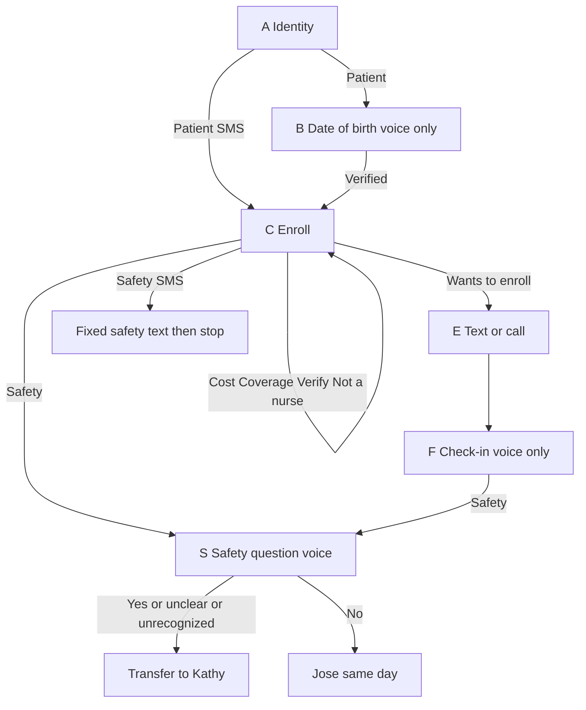

# Alera Health — Integrated Behavioral Health Home Enrollment

**Account:** Alera Health (population health; manages the Ohio ONEcare / OBHPN network)
**Pilot:** about 2,000 to 3,000 adult members, one state (Ohio), phone and text only
**KPI:** percent of members engaged, defined as the **Wants to enroll** bucket
**Demo provider:** Riverside Behavioral Health (stand-in for one provider on a direct panel)
**Demo clinicians:** Kathy Smith (on-call, Tier 1) and Jose (assigned clinician, Tier 2)
**Tokens in SMS:** `{patient}` → Denise · `{hospital}` → Riverside Behavioral Health
**Voice hero:** Marcus

Voice and SMS use the same nodes, the same buckets, and the same configured replies. The only channel differences are date-of-birth verify, the spoken check-in, live transfer, and voicemail.

---

## How this runs in Outreach

The patient can answer in their own words. Outreach classifies that utterance into **one bucket configured on that question**, then plays **only the reply configured for that bucket**.

- A bucket that is not on the question does not get an answer. "What are your hours?" on the enroll question hits **Unrecognized**, not a composed answer.
- Question buckets (cost, coverage, "Is this a scam", "Are you a nurse") end by asking the enroll question again. Each of those buckets can fire **once**. The second time, play **Unrecognized**.
- **Unrecognized** is a real bucket with its own reply. It is not a license to improvise.
- On the safety question, **Unrecognized uses the same reply as Yes or unclear**, then transfers. Do not treat an odd answer as "probably fine."
- The raw utterance is stored on the interaction so the coordinator can read "Text is better, I'm at work days." The patient still hears the Prefers text reply, word for word.
- Do not turn on a generative fallback. If it cannot be said from the tables below, it is not said.

---

## Use case

Alera operates behavioral health networks and helps those providers perform in value-based contracts. Payers identify eligible members. Alera normalizes the list. Outreach contacts the member **for their own provider**. Clinicians only take escalations.

Patients hear the program name **Integrated Behavioral Health Home**: a care coordinator on their provider's team for appointments, medicines, rides, and help keeping Medicaid coverage active. Voluntary. No change to doctors or benefits. No app.

Say "help keeping your coverage active." Never say the member is exempt from the January 1, 2027 Ohio Medicaid work and community engagement requirement, and never say they will not lose coverage.

Provider number in every scripted line that offers a way to verify: **(614) 555-0142** (fictional).

---

## Buckets that exist on every question

Add these to nodes A, B, C, D, E, and F. Same utterances, same next step. Do not write a different safety reply per situation.

| Bucket | Example utterances | Configured reply | Next |
| --- | --- | --- | --- |
| Safety | "I don't want to be here", "I want to hurt myself", "I might hurt someone", "Overdose", "Kill myself", "No point in being here" | Voice: go to node S with no extra words. SMS: send the SMS safety reply in node S and stop the thread | S, or SMS stop |
| Unrecognized | anything that matches no bucket, including a second cost or coverage question | See the unrecognized row on that node | Once, then that node's exit |

---

## Node A — Identity

**Voice prompt:** "Hi, this is an automated assistant calling for {hospital}, in partnership with Alera Health. I'm looking for {patient}. Is this {patient}?"

**SMS prompt:** "Hi, this is {hospital} with Alera Health, using an automated text assistant. Before we continue, are we texting with {patient}?"

| Bucket | Example utterances | Configured reply | Next | Disposition |
| --- | --- | --- | --- | --- |
| Patient | "Yes", "This is Marcus", "Yes who is this", "Yeah" | Voice: "Thanks. For your privacy, can you tell me your date of birth?" SMS: no extra line, go to the enroll prompt | Voice B, SMS C | |
| Wrong number | "Wrong number", "No one here by that name" | "I'm sorry to bother you. I'll take this number off our list." | End | Unable to Verify. Suppress. Do not name the program |
| Caregiver | "This is his mom", "I'm his caregiver", "He isn't home" | "I can share that {patient} may qualify for a free care coordination program through {hospital}. I can't go into their care, and I can't sign them up unless they are on the line. Should we call back when they are available?" | D | |
| Not a real person | "Are you a robot", "Are you a nurse", "Is this a real person" | "I am an automated assistant. I am not a nurse, and I can't give medical advice. You can call {hospital} at (614) 555-0142 to confirm this is real. Is this {patient}?" | A, once | |
| Unrecognized | | "Sorry, I didn't catch that. Is this {patient}?" | A, once, then the wrong-number reply | Unable to Verify |

---

## Node B — Date of birth (voice only)

SMS does not ask this. First name on node A is the SMS check.

| Bucket | Example utterances | Configured reply | Next | Disposition |
| --- | --- | --- | --- | --- |
| Verified | date of birth matches the file | "Thank you." | C | |
| Not a match | a different date | "That doesn't match what we have. Can you tell me your date of birth one more time?" | B retry | |
| Refuses | "I'm not telling you that", "Why do you need that" | "I can't continue without that. You can call {hospital} at (614) 555-0142. Goodbye." | End | Unable to Verify |
| Unrecognized | | "Sorry, I need your date of birth to continue. Can you say the month, day, and year?" | B retry | |

**B retry:** Verified goes to C. Any other bucket except Safety plays the Refuses reply and ends.

---

## Node C — Enroll

This is the question that creates the KPI. **Wants to enroll** sets `enrolled_yes`. No other bucket does.

**Prompt (voice and SMS):** "Because you get care at {hospital}, you qualify for a free program called the Integrated Behavioral Health Home. You'd have your own care coordinator to help with appointments, medicines, rides, and keeping your Medicaid active. It's voluntary and it doesn't change your doctors or your benefits. Would you like to enroll?"

On voice, say "Thanks, {patient}." before the prompt if you just verified the date of birth. On SMS, the thanks is the first line of this prompt.

| Bucket | Example utterances | Configured reply | Next | Disposition |
| --- | --- | --- | --- | --- |
| Wants to enroll | "Yes", "Sign me up", "Yeah okay", "I'm interested" | "Thank you, you're signed up. Is it okay if we text you program information at this number, or would you rather get a call?" | E | Enrolled (Yes). Tier 3 |
| Does not want to enroll | "No", "No thanks", "I'm good", "Not interested" | "That's completely fine. This is voluntary, and we won't contact you again about it. If you change your mind, call {hospital} at (614) 555-0142." | End | Declined. Suppress |
| Cost question | "Does this cost", "Is this gonna cost me", "How much" | "There is no cost to you, and this does not change your doctors or your benefits. Would you like to enroll?" | C, once | |
| Coverage question | "Is my Medicaid changing", "I got a letter about Medicaid", "Will I lose my insurance" | "Your coordinator can help with the paperwork so your coverage stays active. I can't say how any new rule applies to you. Would you like to enroll?" | C, once | |
| Wants to verify | "Is this a scam", "Who is this really", "How did you get my number" | "We will never ask for money or your Social Security number. You can confirm by calling {hospital} at (614) 555-0142. The program is voluntary and it doesn't change your doctors. Would you like to enroll?" | C, once | |
| Not a real person | "Are you a nurse", "Are you a real person" | "I am an automated assistant. I am not a nurse, and I can't give medical advice. You can call {hospital} at (614) 555-0142 to confirm this is real. Would you like to enroll?" | C, once | |
| Wants a person | "Just have someone call me", "I don't want to do this on the phone" | "A care coordinator from {hospital} will call you within 2 business days. We won't enroll you unless you say yes." | End | Callback. Not engaged |
| Unrecognized | a second cost, coverage, or verify question, or anything else | "I want to make sure I understand. Would you like to enroll in the program, yes or no?" | C, once, then the Wants a person reply | Callback if they never hit Wants to enroll |

SMS safety on this node does **not** ask node S. It sends the SMS block under node S and ends the thread.

---

## Node D — Caregiver (only from node A)

Do not enroll. Do not ask an open "what time works" question. A clock time would have no bucket.

| Bucket | Example utterances | Configured reply | Next | Disposition |
| --- | --- | --- | --- | --- |
| Call back | "Yes call later", "Try after 5" | "We'll call back another time. {patient} can also call {hospital} at (614) 555-0142 and ask for care coordination. We still need them on the line to enroll." | End | Caregiver. Tier 3 |
| Says no | "No", "Don't call back" | "Okay. We won't leave details. They can call {hospital} at (614) 555-0142." | End | Caregiver |
| Reports danger | "He's not safe", "I'm scared", "She hasn't picked up her medicine and something's wrong" | "Thank you for telling me. If they are in danger, call 911. You can call or text 988. I'm connecting you with Kathy, a clinician at {hospital}." | Transfer | Caregiver + Tier 1 |
| Unrecognized | | "Should we call back when {patient} is available? Yes or no." | D, once, then Says no | Caregiver |

"Reports danger" is the caregiver safety bucket. It uses this reply, not a new one.

---

## Node E — Text or call

Only reached from **Wants to enroll**. The member is already engaged.

| Bucket | Example utterances | Configured reply | Next | Disposition |
| --- | --- | --- | --- | --- |
| Prefers text | "Yes", "Text me", "Text is better, I'm at work days" | "Got it. Your {hospital} care coordinator will text you within 2 business days." Then the channel close | Voice F, SMS end | Text consent yes. Tier 3. Preference text |
| Prefers a call | "Call me", "Don't text" | "Got it. Your {hospital} care coordinator will call you within 2 business days." Then the channel close | Voice F, SMS end | Text consent no. Tier 3. Preference call |
| Stop | "Stop", "Leave me alone" | "You're signed up, and we won't text you. If you want off the program too, call {hospital} at (614) 555-0142. Goodbye." | End | Stays Enrolled (Yes) unless they clearly refuse the program. Suppress SMS |
| Unrecognized | | "Would you like a text, or a phone call?" | E, once, then Prefers a call | Preference call |

**SMS close (append on Prefers text and Prefers a call):** "If you're ever in crisis, call or text 988, or call 911 if you're in danger. Reply HELP for help. Reply STOP to unsubscribe."

**Voice close** is node F, not this line. Do not read "Reply STOP" on a call.

---

## Node F — Check-in (voice only, after enroll)

**Prompt:** "Before I let you go, are you having trouble getting your medicines, or is there something you need your care team to help with today?"

| Bucket | Example utterances | Configured reply | Next | Disposition |
| --- | --- | --- | --- | --- |
| No issues | "No", "I'm good", "Not today" | "Thank you. You're enrolled. If you're ever in crisis, call or text 988, or call 911 if you are in danger. Goodbye." | End | Enrolled (Yes) |
| Medicine or care problem | "I ran out of my meds", "I haven't picked them up", "I need to see someone" | "Thank you. Jose, a clinician on your {hospital} team, will call you today. If that feels urgent before they reach you, call or text 988, or call 911. Goodbye." | End | Enrolled (Yes) + Tier 2, owner Jose |
| Unrecognized | | "Thanks. You're enrolled, and your coordinator will reach out. If you need help sooner, call {hospital} at (614) 555-0142. Goodbye." | End | Enrolled (Yes) |

Put "I don't see the point", "I don't want to be here", and "I might hurt myself" in the **Safety** bucket, not in Medicine or care problem. A sentence that contains both ("Ran out of my meds" and "Don't see the point") is Safety.

---

## Node S — Safety question (voice)

**Prompt:** "Thank you for telling me. I want to make sure you are safe. Are you having thoughts of hurting yourself or someone else right now?"

| Bucket | Example utterances | Configured reply | Next | Disposition |
| --- | --- | --- | --- | --- |
| Yes or unclear | "Yes", "Maybe", "I don't know", "Kind of", silence | "I'm going to connect you right now with Kathy, a clinician on your {hospital} care team. Please stay on the line. If we get disconnected, call or text 988, or call 911 if you are in danger." | Transfer | Tier 1, owner Kathy Smith |
| No | "No", "I'm not going to hurt myself" | "I'm glad you told me that. A clinician from {hospital} will call you today. If that changes, call or text 988, or call 911. Goodbye." | End | Tier 2, owner Jose |
| Unrecognized | anything else | Same reply as Yes or unclear | Transfer | Tier 1 |

**SMS safety reply** (used instead of this question when Safety hits on a text):

"{patient}, thank you for telling us. You don't have to go through this alone. If you're in danger now, call 911. You can call or text 988 anytime. A clinician from {hospital} is calling you right now. Please stay by your phone. Reply HELP for help. Reply STOP to unsubscribe."

No further SMS question after that.

**Transfer failed** (system branch, not a patient bucket): "I wasn't able to connect you, and I'm still here. If you are in danger, hang up and call 911. You can also call or text 988. I'm notifying Kathy's team to call you back at this number." Case stays open.

**Voicemail** (no answer): "Hi, this is an automated message for {patient} from {hospital} about a program you may qualify for. Please call (614) 555-0142. If this is urgent, call 911, or call or text 988. Goodbye." No program name, no Medicaid. Counts as one attempt. Disposition: Unable to Reach.

---

## Hero paths (what the demo plays)

These are bucket sequences. Every line is the configured reply for that bucket.

### SMS — IBHH Program Enrollment (Denise)

| Step | Node | Bucket her text hits | What she sees |
| --- | --- | --- | --- |
| 0.0 | A | Patient ("Yes who is this") | Identity prompt |
| 1.0 | C | Wants to verify ("Is this a scam lol") | Enroll prompt |
| 2.0 | C | Coverage question ("I got a letter about Medicaid changing and I'm worried") | Verify reply, enroll asked again |
| 3.0 | C | Wants to enroll ("Yes sign me up") | Coverage reply, enroll asked again |
| 4.0 | E | Prefers text ("Text is better, I'm at work days") | Signed-up prompt |
| 5.0 | | | Prefers text reply + 988 close |

She is engaged at step 3.0, when Wants to enroll fires. "At work days" is on the transcript. It does not change the reply.

### SMS — IBHH Safety Escalation

Same node A, then node C. Her reply "Honestly I don't want to be here anymore" hits **Safety**. The thread sends the SMS safety reply and stops. Tier 1, Kathy Smith calls her. This template is the Safety bucket on the enroll question, for rooms where voice transfer cannot be shown.

### Voice — Marcus

| Order | Node | Bucket | Utterance you read as Marcus |
| --- | --- | --- | --- |
| 1 | A | Patient | "Yeah, this is Marcus." |
| 2 | B | Verified | "March 14, 1988." |
| 3 | C | Coverage question | "I got a letter about Medicaid changing and I'm worried." |
| 4 | C | Wants to enroll | "Yeah, sign me up." |
| 5 | E | Prefers text | "Text is fine." |
| 6 | F | Safety | "I ran out of my meds last week, and some days I don't really see the point." |
| 7 | S | Yes or unclear | "I don't know. Maybe." |
| 8 | | Transfer | Kathy picks up |

If you need the other buckets in the room, read the row. Do not invent a reply. Useful alternates: Cost question, Does not want to enroll (Leon), Caregiver (Andre's mother), Medicine or care problem with a clear No on node S (Rosa).

---

## Escalation and dispositions

| Tier | Buckets that open it | Owner |
| --- | --- | --- |
| 1 Immediate | Safety, then Yes or unclear or Unrecognized on node S. Caregiver Reports danger | Kathy Smith. Warm transfer. 988 and 911 are in the reply |
| 2 Same day | Node F Medicine or care problem. Node S No | Jose |
| 3 Routine | Wants to enroll, Wants a person, Caregiver Call back | Provider care coordinator, within 2 business days |
| 4 Close | Does not want to enroll, Wrong number, Stop, voicemail limit | Nobody. Suppress as the disposition says |

**Dispositions:** Enrolled (Yes), Interested is not used (Wants a person is Callback, not a soft yes), Callback, Declined, Unable to Reach, Unable to Verify, Escalated (Safety), Caregiver.

**Engaged** = Enrolled (Yes) only. That is the Wants to enroll bucket. Marcus still counts if he later hits Safety. Andre and Leon do not.

**Attempts:** up to 3 voice attempts and 1 SMS in 10 days. Stop on Enrolled (Yes), Declined, Stop, wrong number, deceased, or Tier 1. A Tier 1 member is not put back into the campaign.

---

## Evolve build notes

Build one Outreach program, **Alera IBHH Enrollment Pilot**. Patient-facing name: Integrated Behavioral Health Home. Channels: outbound voice and outbound SMS.

Each node above is one question. Each table row is one response option. Paste the configured reply. Set the next node. Add the example utterances as the training phrases for that option. Turn unrecognized handling to the Unrecognized row, not to a free-text model reply.

| Record | Demo value | Production |
| --- | --- | --- |
| Organization | Alera Health | Owns the list and the pilot report |
| Care provider | Riverside Behavioral Health | One row per network provider. Caller ID and `{hospital}` come from this row |
| Issue alert, Tier 1 | Kathy Smith | Immediate. Transfer target |
| Issue alert, Tier 2 | Jose | Same calendar day |
| Tier 3 | Care coordinator queue at the provider | Within 2 business days |
| Alera pilot team | 1 data person, 2 nurses | Read the report. They are not transfer targets |

File from Alera: first name, last name, mobile, date of birth, attributed provider, provider main phone. No diagnosis column.

Fields: `member_id`, `provider_id`, `provider_name`, `channel`, `attempt_number`, `node`, `bucket`, `raw_utterance`, `enrolled_yes`, `text_consent`, `preferred_followup`, `escalation_tier`, `escalation_owner`, `transfer_result` (connected, failed, not attempted), `contacted_at`.

**Engaged %** = members with `enrolled_yes` / members on the pilot list. Next to it: reach rate, decline rate, unable to verify, Tier 1 count, Tier 2 count, transfer connect rate, minutes from Tier 1 to clinician contact. Slice by provider.

Do not give the assistant a nurse title. Do not put a diagnosis, a medicine name, or substance use history in a prompt, a reply, or the voicemail. Do not add a bucket whose reply says the member is exempt.

---

## Confirm before go-live

- Program name and which benefit sentences legal will allow. The enroll prompt is the place those sentences go.
- Caller ID: provider, Alera, or both. This script says the provider first, then Alera Health.
- Warm transfer per provider, or the failed-transfer reply plus a page for providers who cannot take one.
- Anyone under 21 on the list. They need a different script. This one is adult only.
